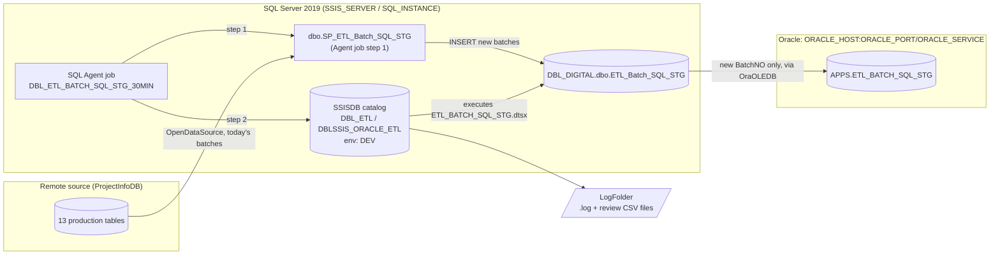
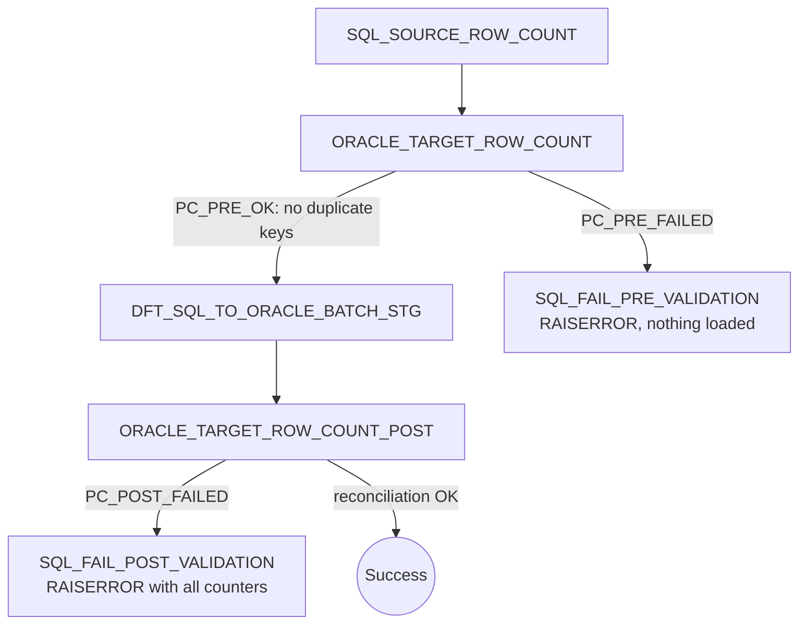
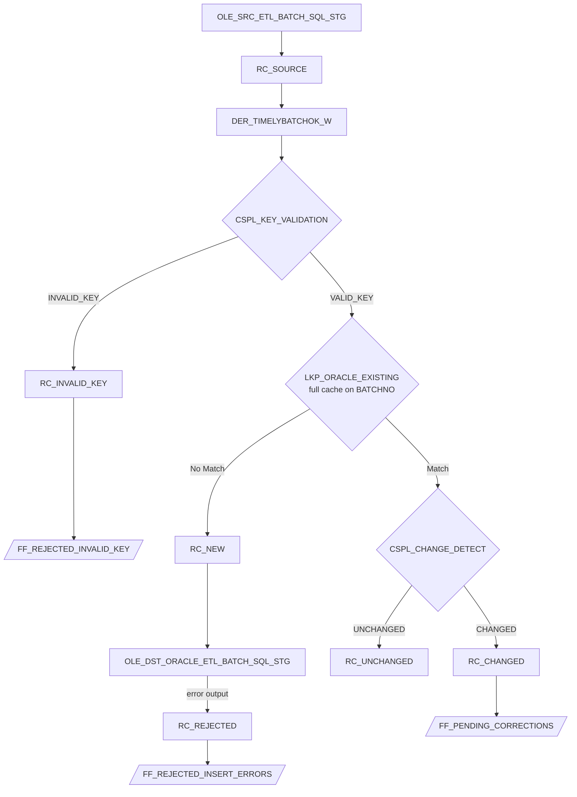

# DBLSSIS_ORACLE_ETL: Technical Documentation

| Item | Value |
|---|---|
| Solution | `DBLSSIS_ORACLE_ETL` (SSIS project, deployment model: Project) |
| Package | `ETL_BATCH_SQL_STG.dtsx` |
| Data flow | SQL Server `DBL_DIGITAL.dbo.ETL_Batch_SQL_STG` → Oracle `APPS.ETL_BATCH_SQL_STG` |
| Schedule | SQL Server Agent, every 30 minutes, 24×7 |
| Environment | DEV (deployed to SSISDB, folder `DBL_ETL`, environment `DEV`) |
| Document version | 1.1 (2026-11-23) |
| Status | Deployed and scheduled on DEV. First scheduled runs are pending verification. |

> **Note on sanitization.** This repository is public. Server addresses, instance names, the Oracle service name and login names have been replaced with placeholder tokens (see [§17](#17-sanitization-tokens)). No credentials of any kind are stored in this repository.

---

## Contents
1. [Purpose and scope](#1-purpose-and-scope)
2. [Architecture](#2-architecture)
3. [Environment and components](#3-environment-and-components)
4. [Data model and column mapping](#4-data-model-and-column-mapping)
5. [Load strategy](#5-load-strategy)
6. [SSIS package design](#6-ssis-package-design)
7. [Data quality gates and fail-safes](#7-data-quality-gates-and-fail-safes)
8. [Security model](#8-security-model)
9. [Deployment (SSISDB)](#9-deployment-ssisdb)
10. [Scheduling (SQL Server Agent)](#10-scheduling-sql-server-agent)
11. [Upstream procedure `SP_ETL_Batch_SQL_STG`](#11-upstream-procedure-sp_etl_batch_sql_stg)
12. [Monitoring and operations](#12-monitoring-and-operations)
13. [Validation and reconciliation](#13-validation-and-reconciliation)
14. [Building the package from source](#14-building-the-package-from-source)
15. [Known issues, risks and recommendations](#15-known-issues-risks-and-recommendations)
16. [Repository layout](#16-repository-layout)
17. [Sanitization tokens](#17-sanitization-tokens)
18. [Change history](#18-change-history)

---

## 1. Purpose and scope

The solution copies dyeing batch records from the SQL Server staging table `DBL_DIGITAL.dbo.ETL_Batch_SQL_STG` into the Oracle E-Business Suite staging table `APPS.ETL_BATCH_SQL_STG`, so that Oracle-side processes can consume them.

**In scope**
- Incremental, append-only transfer keyed on `BatchNO`.
- Detection and reporting (not application) of changed rows.
- Pre-load and post-load validation that stops the run on any inconsistency.
- Deployment to the SSIS catalog (SSISDB) and scheduling through SQL Server Agent.
- A source refresh step (`dbo.SP_ETL_Batch_SQL_STG`) that runs before each load.

**Out of scope (pending an approved correction policy)**
- `UPDATE`, `DELETE` and `MERGE` against the Oracle table.
- Historical versioning (SCD Type 2).
- Database-side run logging tables (DDL proposed, not created).

---

## 2. Architecture



**Run sequence (every 30 minutes):**
1. Agent step 1 runs `EXEC dbo.SP_ETL_Batch_SQL_STG`. It inserts today's batches that are not yet in the staging table.
2. If step 1 succeeds, Agent step 2 executes the SSIS package from SSISDB with environment `DEV`.
3. The package validates both sides, inserts only `BatchNO` values that do not yet exist in Oracle, writes review files, and validates the result.
4. If step 1 fails, the job stops and step 2 does not run.

---

## 3. Environment and components

| Component | Detail |
|---|---|
| SSIS / SQL Server host | `SSIS_SERVER\SQL_INSTANCE`, SQL Server 2019 (15.0.2000.5), TCP 1433. Address in connection strings: `SQLSERVER_HOST` |
| SSIS runtime | SQL Server 2019 Integration Services, **Developer** edition (dev/test only; see §15) |
| SSIS catalog | `SSISDB` (CLR enabled, auto-execution at startup on) |
| Source database | `DBL_DIGITAL`, collation `SQL_Latin1_General_CP1_CI_AS` |
| Target database | Oracle Database 23ai family (release 23.26), charset `AL32UTF8`, NCHAR `AL16UTF16`. EZConnect: `ORACLE_HOST:ORACLE_PORT/ORACLE_SERVICE` |
| Oracle client on server | Oracle Client 19c x64 with OraOLEDB (`OraOLEDB.Oracle.1`), `Authenticated Users` read/execute on the client home |
| SQL connection | `CM_SQLSERVER_DBL_DIGITAL`: provider `SQLNCLI11.1`, SQL authentication (`SQL_LOGIN`) |
| Oracle connection | `CM_ORACLE_TARGET_APPS`: provider `OraOLEDB.Oracle.1`, user `ORACLE_LOGIN` |
| Development tools | Visual Studio 2022 + SQL Server Integration Services Projects extension. Project `TargetServerVersion` = SQL Server 2019 |
| Log folder (DEV) | `D:\ETL_Logs\DBL_DIGITAL_TO_ORACLE` (the SQL Agent service account needs Modify permission) |

The legacy `MSDAORA` provider is intentionally **not** used.

---

## 4. Data model and column mapping

Both tables have 20 columns, all nullable. The Oracle table has no constraints, indexes or triggers. Uniqueness of `BATCHNO` is enforced by the package (§7), not by the database.

| # | Source column (SQL Server) | SQL type | SSIS type | Target column (Oracle) | Oracle type |
|---|---|---|---|---|---|
| 1 | BatchDate | datetime | DT_DBTIMESTAMP | BATCHDATE | DATE |
| 2 | OrderFullNo | nvarchar(100) | DT_WSTR(100) | ORDERFULLNO | NVARCHAR2(100) |
| 3 | UnitName | nvarchar(100) | DT_WSTR(100) | UNITNAME | NVARCHAR2(100) |
| 4 | ColorName | nvarchar(150) | DT_WSTR(150) | COLORNAME | NVARCHAR2(150) |
| 5 | **BatchNO** (business key) | nvarchar(50) | DT_WSTR(50) | **BATCHNO** | NVARCHAR2(50) |
| 6 | FabricDia | nvarchar(50) | DT_WSTR(50) | FABRICDIA | NVARCHAR2(50) |
| 7 | FabricGSM | nvarchar(50) | DT_WSTR(50) | FABRICGSM | NVARCHAR2(50) |
| 8 | OtherQty | decimal(18,4) | DT_NUMERIC(18,4) | OTHERQTY | NUMBER(18,4) |
| 9 | Rolls | decimal(18,4) | DT_NUMERIC(18,4) | ROLLS | NUMBER(18,4) |
| 10 | BuyerShortName | nvarchar(150) | DT_WSTR(150) | BUYERSHORTNAME | NVARCHAR2(150) |
| 11 | Item | nvarchar(150) | DT_WSTR(150) | ITEM | NVARCHAR2(150) |
| 12 | OrderCustomerType | nvarchar(50) | DT_WSTR(50) | ORDERCUSTOMERTYPE | NVARCHAR2(50) |
| 13 | BatchQty | decimal(18,4) | DT_NUMERIC(18,4) | BATCHQTY | NUMBER(18,4) |
| 14 | BatchGreyQty | decimal(18,4) | DT_NUMERIC(18,4) | BATCHGREYQTY | NUMBER(18,4) |
| 15 | CustomerTypeQty | decimal(18,4) | DT_NUMERIC(18,4) | CUSTOMERTYPEQTY | NUMBER(18,4) |
| 16 | FabricTypeName | nvarchar(150) | DT_WSTR(150) | **FABRICTYPE** (renamed) | NVARCHAR2(150) |
| 17 | DyeingStartDate | datetime | DT_DBTIMESTAMP | DYEINGSTARTDATE | DATE |
| 18 | TimelyBatchOK | char(1) | DT_STR(1, 1252) → `TimelyBatchOK_W` DT_WSTR(1) | TIMELYBATCHOK | CHAR(1 BYTE) |
| 19 | GreyReceiveTypeName | nvarchar(150) | DT_WSTR(150) | GREYRECEIVETYPENAME | NVARCHAR2(150) |
| 20 | PrdFloor | nvarchar(100) | DT_WSTR(100) | PRDFLOOR | NVARCHAR2(100) |

**Data type handling**
- **DATETIME → DATE.** Oracle `DATE` has no fractional seconds. The source query truncates milliseconds (`DATEADD(MILLISECOND, -DATEPART(MILLISECOND, col), col)`), so values compare equal after a round trip.
- **CHAR(1).** In an `AL32UTF8` database, OraOLEDB reports `CHAR(1 BYTE)` as `DT_WSTR`. A Derived Column creates the Unicode copy `TimelyBatchOK_W`. That copy is mapped to the destination, compared during change detection, and written to the Unicode CSV files. The Lookup query casts the Oracle column to `NVARCHAR2(1)` for the same reason.
- **Numbers.** `decimal(18,4)` maps to `NUMBER(18,4)` without loss.

---

## 5. Load strategy

| Decision | Choice | Rationale |
|---|---|---|
| Strategy | **A: incremental append** | The source is a growing staging table. Re-reading everything and appending only what is missing is simple and safe to re-run. |
| Business key | `BatchNO` (globally unique) | Verified unique in the source data. Every comparison uses this key alone. |
| New key (not in Oracle) | `INSERT` | |
| Existing key, identical values | Skip | |
| Existing key, different values | **Report only** to `Pending_Corrections_<RunStamp>.csv` (policy **P1**) | The Oracle row is never modified. Corrections need an approved policy before any `UPDATE` or `MERGE` is built. |
| NULL or blank key | Reject to `Rejected_InvalidKey_<RunStamp>.csv`; the run fails post-validation | |
| Oracle insert error | Redirect to `Rejected_InsertErrors_<RunStamp>.csv`; the run fails post-validation | |
| Truncate target | **Never** | |

**Idempotence and recovery.** The Oracle insert is not wrapped in a distributed transaction. If a run fails part-way through, rows already inserted remain. The next run's Lookup sees those rows and skips them, so re-running the package is the recovery procedure. No manual cleanup is needed.

---

## 6. SSIS package design

### 6.1 Parameters, variables and connection managers

| Name | Kind | Purpose |
|---|---|---|
| `$Package::LogFolder` | Package parameter (String, not sensitive) | Folder for the text log and review CSV files. In SSISDB it is bound to `ENV_LOG_FOLDER`. |
| `User::RunStamp` | Variable (expression) | `yyyyMMdd_HHmmss` from `System::StartTime`; used to name each run's files |
| `User::SourceRows`, `SourceInvalidKeys`, `SourceDupKeys` | Int32 | Source profile before the load |
| `User::TargetRowsBefore`, `TargetDupKeys`, `TargetRowsAfter` | String | Oracle counts (returned via `TO_CHAR` because Oracle `NUMBER` does not bind to Int32) |
| `User::RcSource`, `RcInvalidKey`, `RcNew`, `RcUnchanged`, `RcChanged`, `RcRejected` | Int32 | Row Count transforms in the data flow |
| `CM_SQLSERVER_DBL_DIGITAL` | Project connection manager | Source (OLE DB, SQLNCLI11) |
| `CM_ORACLE_TARGET_APPS` | Project connection manager | Target (OLE DB, OraOLEDB) |
| `FF_CM_*` (3) | Package flat file connection managers | Review CSV files; `ConnectionString` expression `LogFolder\<name>_<RunStamp>.csv` |
| `FILE_CM_ETL_TEXT_LOG` | Package file connection manager | Text log `LogFolder\ETL_BATCH_SQL_STG_<RunStamp>.log` |

### 6.2 Control flow



| Task | Connection | Action |
|---|---|---|
| `SQL_SOURCE_ROW_COUNT` | SQL | Read-only. Total rows, NULL/blank `BatchNO` count, number of duplicate `BatchNO` groups |
| `ORACLE_TARGET_ROW_COUNT` | Oracle | Read-only. Target rows and duplicate `BATCHNO` groups. Uses a `CROSS JOIN` of two inline views (a scalar subquery next to `COUNT(*)` without `GROUP BY` raises ORA-00937). |
| `DFT_SQL_TO_ORACLE_BATCH_STG` | both | The data flow (§6.3) |
| `ORACLE_TARGET_ROW_COUNT_POST` | Oracle | Read-only. Target rows after the load |
| `SQL_FAIL_PRE_VALIDATION` / `SQL_FAIL_POST_VALIDATION` | SQL | Run `RAISERROR(..., 16, 1)` with a diagnostic message. They change no data; their only job is to fail the package. |

### 6.3 Data flow `DFT_SQL_TO_ORACLE_BATCH_STG`



| Component | Notes |
|---|---|
| `OLE_SRC_ETL_BATCH_SQL_STG` | SQL command reading all 20 columns from `dbo.ETL_Batch_SQL_STG`, with datetimes truncated to whole seconds. Errors and truncation fail the component. |
| `DER_TIMELYBATCHOK_W` | `(DT_WSTR,1)[TimelyBatchOK]` |
| `CSPL_KEY_VALIDATION` | `ISNULL([BatchNO]) \|\| TRIM([BatchNO]) == ""` → `INVALID_KEY` |
| `LKP_ORACLE_EXISTING` | Full cache. Query: `SELECT <20 columns> FROM APPS.ETL_BATCH_SQL_STG WHERE BATCHNO IS NOT NULL`. Joins on `BATCHNO`, returns current Oracle values as `TGT_*`, and sends non-matches to the No Match output. |
| `OLE_DST_ORACLE_ETL_BATCH_SQL_STG` | Table access mode (`"APPS"."ETL_BATCH_SQL_STG"`). Error rows are redirected, not failed. |
| `CSPL_CHANGE_DETECT` | NULL-safe comparison of all 19 non-key columns (`ISNULL(a) ? "" : a` for strings; NULL/NULL counts as equal for numbers and dates) |
| `FF_*` destinations | Unicode, comma-delimited, header row, text-qualified (`"`), overwrite. Insert errors add `ErrorCode` and `ErrorColumn`; pending corrections add every `TGT_*` column beside the source values. |

### 6.4 Logging and output files

| Output | Location | Content |
|---|---|---|
| SSISDB operational log | `SSISDB.catalog.executions` and `catalog.event_messages` | Logging level **Basic** (set by the Agent job) |
| Text log | `LogFolder\ETL_BATCH_SQL_STG_<RunStamp>.log` | `OnError`, `OnWarning`, `OnTaskFailed`, `OnPreExecute`, `OnPostExecute`, `OnInformation` |
| Review CSV files | `LogFolder\Pending_Corrections_<RunStamp>.csv`, `Rejected_InsertErrors_<RunStamp>.csv`, `Rejected_InvalidKey_<RunStamp>.csv` | Header plus rows. A file is created on every run, even when it holds no rows. |

At 48 runs per day this produces about 192 files per day. A retention job is recommended (§15).

---

## 7. Data quality gates and fail-safes

| Gate | Condition (SSIS expression) | On failure |
|---|---|---|
| **Pre-load** (`PC_PRE_OK`) | `SourceDupKeys == 0 && TargetDupKeys == 0` | The data flow is skipped and `SQL_FAIL_PRE_VALIDATION` raises an error. **No rows are loaded.** |
| **Post-load: row conservation** | `RcSource == RcInvalidKey + RcNew + RcUnchanged + RcChanged` | `SQL_FAIL_POST_VALIDATION` raises an error listing every counter |
| **Post-load: target delta** | `TargetRowsAfter − TargetRowsBefore == RcNew − RcRejected` | same |
| **Post-load: no rejects** | `RcRejected == 0 && RcInvalidKey == 0` | same |

Changed rows (`RcChanged > 0`) do **not** fail the run. They are reported in `Pending_Corrections_*.csv` for review.

---

## 8. Security model

| Area | Implementation |
|---|---|
| Package protection level | `EncryptSensitiveWithUserKey` (development) |
| Runtime credentials | Held only in SSISDB environment `DEV` as **sensitive** variables (`ENV_SQL_PASSWORD`, `ENV_ORA_PASSWORD`). These are bound to `CM_SQLSERVER_DBL_DIGITAL.Password` and `CM_ORACLE_TARGET_APPS.Password`. SSISDB encrypts them with the catalog master key. |
| Deployment behaviour | Deploying with a different Windows user shows "Failed to decrypt sensitive data with user key". This is expected: credentials are supplied by the SSISDB environment, not by the package. |
| Execution identity | The Agent job step runs as the SQL Agent service account (`NT Service\SQLAgent$SQL_INSTANCE`). Deploying and executing in SSISDB requires Windows authentication. |
| Source control | Encrypted password elements and the project password verifier are **removed** from the committed `.conmgr` and `.dtproj` files. Connection strings use placeholder tokens. No credentials, data extracts or validation outputs are committed. |
| Upstream procedure | Contains an embedded SQL login credential in an `OpenDataSource` call. **Open security finding:** see §11 and §15. The procedure source is deliberately not in this repository. |

---

## 9. Deployment (SSISDB)

### 9.1 Server prerequisites
1. SQL Server 2019 Database Engine and Integration Services on a **licensed, non-evaluation** edition. An expired Evaluation shared feature fails every execution with "Integration Services evaluation period has expired".
2. SSISDB catalog created (requires CLR integration and a catalog encryption password, kept by the DBA).
3. Oracle Client 19c **x64** with OraOLEDB registered. SSISDB executes packages in 64-bit mode. The server must reach `ORACLE_HOST:ORACLE_PORT` (verify with `tnsping`).
4. Log folder created, with **Modify** granted to the SQL Agent service account:
   ```powershell
   icacls 'D:\ETL_Logs\DBL_DIGITAL_TO_ORACLE' /grant 'NT Service\SQLAgent$SQL_INSTANCE:(OI)(CI)M'
   ```
5. SQL Server Agent service set to **Automatic** startup.

### 9.2 Build and deploy
1. Open `src/DBLSSIS_ORACLE_ETL/DBLSSIS_ORACLE_ETL.sln` in Visual Studio. Replace the placeholder tokens in the two `.conmgr` files with the real environment values.
2. **Build** to produce `bin\Development\DBLSSIS_ORACLE_ETL.ispac`.
3. Copy the `.ispac` to the server and run `ISDeploymentWizard.exe` (Windows authentication). Target: `/SSISDB/DBL_ETL/DBLSSIS_ORACLE_ETL`.

### 9.3 Catalog configuration
1. Under `SSISDB → DBL_ETL → Environments`, create `DEV` with:

   | Variable | Type | Sensitive | Value |
   |---|---|---|---|
   | `ENV_LOG_FOLDER` | String | No | `D:\ETL_Logs\DBL_DIGITAL_TO_ORACLE` |
   | `ENV_SQL_PASSWORD` | String | **Yes** | entered by the operator |
   | `ENV_ORA_PASSWORD` | String | **Yes** | entered by the operator |

2. Project → **Configure → References**: add environment `DEV`. This must be done **before** binding values; until then the "Use environment variable" option is disabled.
3. **Parameters**: bind `LogFolder` → `ENV_LOG_FOLDER`.
4. **Connection Managers**: bind `CM_SQLSERVER_DBL_DIGITAL.Password` → `ENV_SQL_PASSWORD` and `CM_ORACLE_TARGET_APPS.Password` → `ENV_ORA_PASSWORD`.
5. **Validate** with environment `DEV`. `catalog.validations.status = 7` is not enough on its own: also confirm there are no rows with `message_type` 120 (error) or 110 (warning) in `catalog.event_messages`.

A sensitive variable can only be bound to a sensitive target. Binding `ENV_*_PASSWORD` to `LogFolder` fails validation with "Unable to map an environment variable with the sensitive property set to True…".

---

## 10. Scheduling (SQL Server Agent)

Job **`DBL_ETL_BATCH_SQL_STG_30MIN`** is created by `deployment/create_agent_job_30min.sql` and then extended by `deployment/add_proc_step_to_job.sql`. Both scripts check their preconditions and run inside a transaction.

| Step | Name | Subsystem | On success | On failure |
|---|---|---|---|---|
| 1 | Refresh source staging (SP_ETL_Batch_SQL_STG) | T-SQL, database `DBL_DIGITAL`: `EXEC dbo.SP_ETL_Batch_SQL_STG;` | Go to step 2 | Quit, report failure |
| 2 | Run ETL_BATCH_SQL_STG (SSISDB, env DEV) | SSIS (catalog) | Quit, report success | Quit, report failure |

- **Schedule:** `Every 30 minutes (24x7)`: daily, every 30 minutes, from 00:00:00 to 23:59:59.
- **Owner:** `sa`.
- **Step 2 command:** `/ISSERVER \SSISDB\DBL_ETL\DBLSSIS_ORACLE_ETL\ETL_BATCH_SQL_STG.dtsx`, `/ENVREFERENCE <id of DBL_ETL\DEV>`, `LOGGING_LEVEL = 1` (Basic), `SYNCHRONIZED = True`. Because the step waits for the package to finish, the step status equals the package status.
- **Concurrency:** Agent never starts a job that is still running, so runs cannot overlap. Running the procedure and the package in one job guarantees they execute in that order. Two separate jobs on the same schedule would race.

Manual start:
```sql
EXEC msdb.dbo.sp_start_job @job_name = N'DBL_ETL_BATCH_SQL_STG_30MIN';
```

---

## 11. Upstream procedure `SP_ETL_Batch_SQL_STG`

`DBL_DIGITAL.dbo.SP_ETL_Batch_SQL_STG` is owned by the source team and is not modified by this project. Behaviour as reviewed:

- Reads 13 tables from a remote `ProjectInfoDB` through `OpenDataSource('SQLOLEDB', …)`. This requires *Ad Hoc Distributed Queries* to be enabled.
- Window: `@FromDate` = today 00:00 and `@ToDate` = tomorrow 00:00.
- Filters: `UnitName = 'CCL'`, `OrderCustomerType IN ('FABRIC SELL', 'OWN', 'SUB')`.
- Aggregates by `BatchDate, BatchNO` and inserts only groups for which `NOT EXISTS (… T.BatchDate = BCH.BatchDate AND T.BatchNO = BCH.BatchNO)`. It is therefore safe to run every 30 minutes.

**Findings (each needs an owner decision before any change):**

| # | Finding | Impact | Recommendation |
|---|---|---|---|
| P-1 | A SQL login and password are embedded in plain text in the `OpenDataSource` connection string | Credential exposure to anyone who can read the procedure definition | Rotate the password. Replace `OpenDataSource` with a **Linked Server** that uses a stored login mapping, or Windows authentication. |
| P-2 | The window starts at today 00:00 | Batches dated yesterday but created after the 23:30 run are never picked up | Use a look-back window, for example `@FromDate = DATEADD(DAY, -1, CAST(GETDATE() AS date))`. The `NOT EXISTS` check already prevents duplicates. |
| P-3 | Duplicate check uses `(BatchDate, BatchNO)` while the ETL key is `BatchNO` alone | If a `BatchNO` reappears with a different date, the staging table gets a duplicate key. The SSIS pre-load gate then fails every run until the duplicate is fixed. | Check on `BatchNO` only |

---

## 12. Monitoring and operations

### 12.1 Monitoring script and procedure
Two equivalent, read-only options return the same five result sets:

| Option | How to use |
|---|---|
| Ad hoc script `deployment/monitor_etl_job.sql` | Open it in SSMS on the SSIS server and execute it. Change `@hours` to set the look-back period (default 24). |
| Stored procedure `dbo.usp_Monitor_ETL_Batch_SQL_STG` (`deployment/usp_Monitor_ETL_Batch_SQL_STG.sql`) | Create it once in `DBL_DIGITAL` (`CREATE OR ALTER`), then run `EXEC dbo.usp_Monitor_ETL_Batch_SQL_STG;` |

Procedure parameters (all optional):

| Parameter | Default | Meaning |
|---|---|---|
| `@job_name` | `DBL_ETL_BATCH_SQL_STG_30MIN` | Agent job to report on |
| `@hours` | `24` | Look-back window for job and SSIS runs |
| `@folder_name` / `@project_name` / `@package_name` | `DBL_ETL` / `DBLSSIS_ORACLE_ETL` / `ETL_BATCH_SQL_STG.dtsx` | SSISDB package to report on |
| `@source_days` | `7` | Days shown in the source daily count |

```sql
EXEC dbo.usp_Monitor_ETL_Batch_SQL_STG;                          -- last 24 hours
EXEC dbo.usp_Monitor_ETL_Batch_SQL_STG @hours = 72;              -- last 3 days
EXEC dbo.usp_Monitor_ETL_Batch_SQL_STG @hours = 6, @source_days = 2;
```

The caller needs read access to `msdb` job tables, to the `SSISDB` catalog views, and to `DBL_DIGITAL.dbo.ETL_Batch_SQL_STG`. The row-count parser guards `SUBSTRING` with `CASE`, because SQL Server can evaluate the expression before the `LIKE` filter and raise "Invalid length parameter" on other messages.

| Result set | Shows |
|---|---|
| 1. NOW | Whether the job is enabled, whether it is running now, the last outcome, and the next scheduled run |
| 2. JOB RUNS | One row per run: start, end and duration; step 1 and step 2 status and duration; the failure message |
| 3. SSIS RUNS | One row per SSISDB execution: status, duration, and **rows inserted into Oracle**, plus rejected and pending-correction counts (parsed from the "wrote N rows" messages) |
| 4. SSIS ERRORS | Error and warning messages of failed executions |
| 5. SOURCE DAILY | Source rows per `BatchDate` for the last 7 days |

Healthy run: `job_outcome = Succeeded`, both steps `OK`, `ssis_status = Succeeded`. `inserted_to_oracle = 0` is normal when no new batches arrived. `NULL` means the data flow did not run; check result set 4.

Compare against Oracle:
```sql
SELECT TRUNC(BATCHDATE) AS BATCH_DATE, COUNT(*) AS ORACLE_ROWS
FROM APPS.ETL_BATCH_SQL_STG
WHERE BATCHDATE >= TRUNC(SYSDATE) - 7
GROUP BY TRUNC(BATCHDATE) ORDER BY 1 DESC;
```

### 12.2 Retention notes
- **Agent job history** keeps at most 100 rows per job by default. At 3 rows per run, that is about the last 16 hours.
- **SSISDB** keeps operations for 365 days by default. Use it for longer history and lower the retention once volume is known.

### 12.3 Troubleshooting

| Symptom | Cause | Resolution |
|---|---|---|
| `ORA-00937: not a single-group group function` | Scalar subquery next to an aggregate in an Oracle Execute SQL task | Use inline views with `CROSS JOIN`. Design-time validation does not execute Execute SQL statements, so this error only appears at runtime. |
| `Provider cannot be found` / OraOLEDB not registered | Oracle client missing, 32/64-bit mismatch, or a process started before the client's `PATH` entry existed | Install the x64 client, then restart the process or service |
| `Integration Services evaluation period has expired` | Shared SSIS feature on an expired Evaluation edition | Run Edition Upgrade with licensed media |
| `Unable to map an environment variable with the sensitive property…` | Sensitive variable bound to a non-sensitive parameter | Fix the binding (§9.3) |
| `Failed to decrypt sensitive data with user key` (deploy warning) | Expected with `EncryptSensitiveWithUserKey` | Supply passwords through the SSISDB environment |
| Step 2 fails writing `.log` or `.csv` files | Agent service account lacks Modify on `LogFolder` | `icacls` grant (§9.1) |
| `ETL pre-validation failed: duplicate BatchNO groups…` | Duplicate keys in the source or target | Investigate and fix the duplicates. Nothing was loaded. |
| `ETL post-validation failed…` | Rejected rows, invalid keys, or a count mismatch | Inspect the `Rejected_*` CSV files for that `RunStamp`, fix the data, and re-run. The design is idempotent (§5). |

---

## 13. Validation and reconciliation

`validation/phaseE_sqlserver_recon.sql` and `validation/phaseE_oracle_recon.sql` compute the same **47 metrics** on each side and output them in identical format:
- row count and distinct key count
- minimum, maximum and sum of seconds for each date column
- sum of each numeric column
- NULL count for each column (wrapped in `ISNULL`/`NVL(..., 0)`)
- total character length of each string column
- distribution of `TimelyBatchOK` values

**DEV results (2026-11-23)**

| Run | Source rows | Inserted | Oracle rows | Reconciliation |
|---|---|---|---|---|
| Initial load | 134 | 134 | 134 | |
| Incremental load | 209 | 75 (new source rows only) | 209 | **47/47 metrics match, 0 duplicate keys** |

Other scripts:
- `*_step2_metadata.sql`: column metadata on both sides
- `sqlserver_phaseA_profile.sql`: source data profile
- `sqlserver_ssis_readiness.sql`: SSISDB and Agent readiness
- `oracle_test_target_count.sql`: standalone test of the pre-load Oracle query

All are read-only.

---

## 14. Building the package from source

`tools/package_generator` regenerates `ETL_BATCH_SQL_STG.dtsx` with the SSIS 2019 object model, without connecting to any database. Column metadata is embedded in `PkgBuilder.cs`.

```powershell
cd tools\package_generator
.\build.ps1 -OutFile .\output\ETL_BATCH_SQL_STG.generated.dtsx
```

`build.ps1` compiles `PkgBuilder.cs` against the SSIS 2019 assemblies in the GAC (version 15.0.0.0). It saves a raw package, swaps the temporary connections for the project connection managers by ID, keeps the original package `DTSID`, and writes the final file.

The committed `src/.../ETL_BATCH_SQL_STG.dtsx` is the **Visual Studio-saved** version and is the source of truth. The generator is a reproducible starting point; after regeneration, open and save the package in Visual Studio before use.

---

## 15. Known issues, risks and recommendations

| # | Item | Priority | Status |
|---|---|---|---|
| R-1 | Embedded credential in the upstream procedure (P-1): rotate it and move to a Linked Server | **High** | Awaiting decision |
| R-2 | Midnight gap in the procedure window (P-2) | High | Awaiting decision |
| R-3 | Procedure duplicate check not aligned with the `BatchNO` key (P-3) | Medium | Awaiting decision |
| R-4 | SQL Server Developer edition is licensed for dev/test only. Production needs Standard or Enterprise. | **High** (before production) | Open |
| R-5 | `sa` used by the SQL connection manager. Create a least-privilege login (read on the source table). | High | Open |
| R-6 | `SQLNCLI11` is deprecated. Move to `MSOLEDBSQL`. | Medium | Open |
| R-7 | Back up the SSISDB master key and store the catalog password in a vault | High | Open |
| R-8 | Retention cleanup for `LogFolder` (about 192 files per day) | Medium | Open |
| R-9 | Database Mail alert (operator notification) on job failure | Medium | Open |
| R-10 | Run log table `ETL_RUN_LOG` (DDL proposed, not created) | Low | Awaiting approval |
| R-11 | Every run reads the full source table and caches the full Oracle table in the Lookup. Fine at current volume; add a date window or partial cache as volume grows. | Low | Monitor |
| R-12 | The destination uses table access mode (row-by-row through OraOLEDB). Fine at current volume; review if batch sizes grow. | Low | Monitor |
| R-13 | Correction policy for changed rows (P1 reports only). `UPDATE`/`MERGE` need an approved policy. | Medium | Awaiting decision |
| R-14 | Other instances on the host carry an expired Evaluation edition (stopped) | Low | Inform the server administrator |

---

## 16. Repository layout

```
├── README.md
├── docs/
│   └── TECHNICAL_DOCUMENTATION.md      this document
├── src/DBLSSIS_ORACLE_ETL/             SSIS project (Visual Studio)
│   ├── DBLSSIS_ORACLE_ETL.sln / .dtproj / .database / Project.params
│   ├── ETL_BATCH_SQL_STG.dtsx          the package
│   ├── CM_SQLSERVER_DBL_DIGITAL.conmgr source connection (tokenized, no password)
│   └── CM_ORACLE_TARGET_APPS.conmgr    target connection (tokenized, no password)
├── deployment/
│   ├── create_agent_job_30min.sql      creates the Agent job (SSIS step + schedule)
│   ├── add_proc_step_to_job.sql        inserts the procedure as step 1
│   ├── monitor_etl_job.sql             read-only monitoring (ad hoc script)
│   └── usp_Monitor_ETL_Batch_SQL_STG.sql  same monitoring as a stored procedure
├── validation/                         read-only profiling, readiness and reconciliation scripts
└── tools/package_generator/            programmatic package builder (C# + PowerShell)
```

Not committed: `bin/`, `obj/`, `*.user`, `*.ispac`, local backups, and validation output files (they contain data).

---

## 17. Sanitization tokens

Replace these tokens with real values only in a private working copy. Never commit real values to this repository.

| Token | Meaning |
|---|---|
| `SQLSERVER_HOST` | Network address of the SQL Server source |
| `SSIS_SERVER` | Windows host running SQL Server, SSISDB and SQL Agent |
| `SQL_INSTANCE` | Named SQL Server instance |
| `ORACLE_HOST` / `ORACLE_PORT` / `ORACLE_SERVICE` | Oracle EZConnect address parts |
| `SQL_LOGIN` | SQL authentication login of the source connection manager |
| `ORACLE_LOGIN` | Oracle login of the target connection manager |
| `CM_ORACLE_TARGET_APPS` | Oracle connection manager (the private working copy names it after the Oracle service) |
| `DEV_WORKSTATION` / `DEV_USER` | Package creator metadata |

---

## 18. Change history

| Version | Date | Change |
|---|---|---|
| 1.0 | 2026-11-23 | Initial release: package built and validated, initial and incremental loads reconciled, deployed to SSISDB (DEV), 30-minute Agent job with the source refresh step, monitoring script |
| 1.1 | 2026-11-23 | Added monitoring procedure `dbo.usp_Monitor_ETL_Batch_SQL_STG`. Hardened row-count parsing in the monitoring script. |
